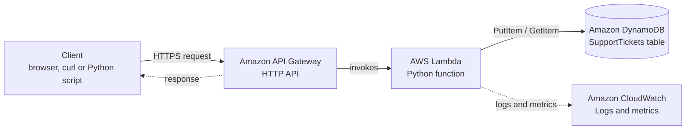

# Architecture

## Diagram

Solid arrows are the request path. Dotted arrows are supporting flows: Lambda writes its logs to CloudWatch, and the response travels back to the client.

## What each part does (beginner version)

| Part | What it is | What it does in this project |
|---|---|---|
| **Client** | Anything that can send an HTTPS request | Your browser, `curl`, or `experiments/latency_test.py` |
| **API Gateway (HTTP API)** | A managed "front door" for your code | Gives you a public URL, receives the request and passes it to Lambda. Throttling limits are set in `template.yaml` so accidental bursts are rejected |
| **Lambda** | Code that runs only when called, with no server for you to manage | `src/app.py` checks the JSON, creates a ticket ID and talks to DynamoDB |
| **DynamoDB** | A managed key-value database | Stores one item per ticket, keyed by `ticketId`. On-demand mode means you pay per read or write, not for idle capacity |
| **CloudWatch** | AWS's logging and metrics service | Stores Lambda logs, including the `REPORT` line for each request (Duration, Billed Duration, Memory Size, Init Duration on cold starts) |

## Routes

| Method and path | Touches DynamoDB? | Success response |
|---|---|---|
| `GET /health` | No | `200` `{"status": "ok", ...}` |
| `POST /tickets` | Yes (one write) | `201` `{"ticketId": "...", "status": "OPEN"}` |
| `GET /tickets/{ticketId}` | Yes (one read) | `200` with the ticket, or `404` |

## Life of one `POST /tickets` request

1. The client sends JSON to `https://<api-id>.execute-api.<region>.amazonaws.com/tickets`.
2. API Gateway matches the route and calls the Lambda function with an event (payload format 2.0).
3. If no execution environment is free, Lambda creates one and runs the code outside the handler first (the **INIT** phase). This is where a cold start spends its time. Otherwise it reuses a warm environment.
4. `lambda_handler` validates the JSON, makes a UUID and a UTC timestamp, and writes the item to DynamoDB.
5. Lambda returns `201` with the ticket ID. API Gateway forwards it to the client.
6. Lambda writes a `REPORT` line to CloudWatch with the measured and billed duration.

## Why this design

- **No servers to manage or pay for while idle.** There is no EC2, load balancer, NAT gateway or database server.
- **Same pattern as Freshworks Marketplace apps**, which run as event-driven Lambda functions at far larger scale. This project is a tiny model of that serverless layer, not of the whole Freshworks platform.
- **Few moving parts**, so three students can understand and demonstrate every piece.

## Resources created by `template.yaml`

| Resource | Type | Billing model |
|---|---|---|
| `TicketHttpApi` | API Gateway HTTP API | Per request |
| `TicketFunction` | Lambda function | Per request plus GB-seconds of billed duration |
| `SupportTicketsTable` | DynamoDB table, on-demand | Per read and write request unit, plus storage |
| `TicketFunctionLogGroup` | CloudWatch log group | Per GB of logs ingested and stored (retention set to 7 days by default) |
| IAM role for the function | IAM | No charge |

Deploying with `sam deploy --resolve-s3` also creates a small S3 bucket for the code package, outside this template. See `docs/cost-and-safety.md`.
